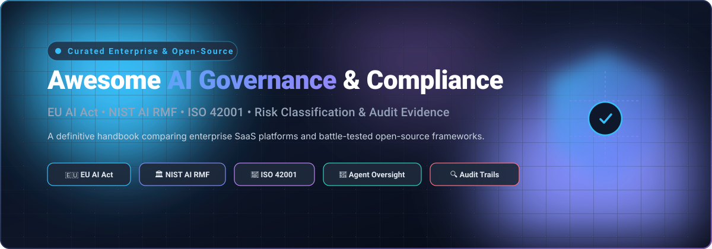

# 🛡️ Awesome AI Governance & Compliance Framework

  <strong>A curated handbook of Enterprise SaaS platforms and battle-tested Open-Source projects for AI Governance, Risk Management, Regulatory Compliance (EU AI Act, NIST AI RMF, ISO 42001), and Agent Oversight.</strong>

  
  
  
  
  
  
  

---

## 📌 Executive Summary & Key Highlights

This repository tracks premier **SaaS platforms** and **open-source frameworks** designed for **AI Governance, Risk & Compliance (AI-GRC)**. These solutions empower organizations to:
- 📋 **Catalog & Inventory AI Systems**: Maintain authoritative registries of models, datasets, LLMs, and autonomous agents across the enterprise lifecycle.
- ⚖️ **Map Regulatory Obligations**: Harmonize automated internal controls directly against the **EU AI Act**, **NIST AI RMF (1.0)**, **ISO/IEC 42001**, and **OWASP Top 10 for LLMs**.
- 🛡️ **Enforce Runtime Guardrails & Agent Oversight**: Monitor prompt injections, toxic content, data leakage, and autonomous agent tool-calling in real-time.
- 🔏 **Generate Tamper-Evident Evidence**: Collect cryptographic audit logs, model cards, and conformity declarations to survive enterprise regulatory audits without vendor lock-in.

---

## 📑 Table of Contents

- [📊 Sector Overview & Market Dynamics](#-sector-overview--market-dynamics)
- [🏢 SaaS / Hosted Platforms](#-saashosted-platforms)
- [🔓 Open-Source GitHub Projects](#-open-source-github-projects)
  - [Open-Source Solutions Ranked by Stars](#open-source-solutions-ranked-by-stars)
  - [Detailed Project Breakdown](#detailed-project-breakdown)
- [🤝 How to Contribute](#-how-to-contribute)
- [💖 Support & Sponsorship](#-support--sponsorship)
- [📈 Star History](#-star-history)
- [⚠️ Disclaimer](#️-disclaimer)

---

## 📊 Sector Overview & Market Dynamics

The global **AI Governance and Compliance** market is estimated at **$250M–$2.6B in 2025** and projected to surge past **$415M–$3.3B by 2026** (expanding at an aggressive **24%–36% CAGR**), driven by urgent compliance milestones across the **EU AI Act**, SEC disclosures, and ISO/IEC 42001 certifications. 

The sector is currently **moderately fragmented** among specialized point tools tackling niche disciplines (such as adversarial red-teaming, runtime LLM guardrails, PII data masking, and cryptographic agent tracing). However, it is experiencing rapid consolidation: cloud hyperscalers (Microsoft, AWS, Google Cloud) and legacy Governance, Risk, and Compliance (GRC) leaders (OneTrust, AuditBoard/Optro, IBM) are systematically acquiring and integrating specialized capabilities into comprehensive, horizontal enterprise governance suites.

---

## 🏢 SaaS/Hosted Platforms

The following enterprise platforms offer turnkey compliance management, model risk inventories, and regulatory mapping workflows. Entries are sorted in **descending order by company valuation / revenue**:

| Company / Product | Company Size (Valuation / Revenue) | Pricing | Free Tier / Free Trial Limits | Key Focus & Strengths |
| :--- | :--- | :--- | :--- | :--- |
| **[Microsoft Purview DSPM for AI](https://learn.microsoft.com/en-us/purview/ai-microsoft-purview)** | ~$3.8T–$3.9T Market Cap / ~$282B+ Rev (FY25) | Starts at **$12/user/month** (standalone Purview Suite add-on) or included in **Microsoft 365 E5 at $60/user/month**; multi-cloud scanning billed via pay-as-you-go Azure meters | **No dedicated standalone free tier**; 30-day trial available via Microsoft 365 E5 / Purview enterprise trial (up to 25 user licenses) | Single-pane visibility into enterprise Copilot and third-party generative AI usage, sensitive-data exposure detection, and automated labeling. |
| **[IBM watsonx.governance](https://www.ibm.com/products/watsonx-governance)** | ~$231B Market Cap / ~$67.5B Rev (FY25) | **Lite: $0/month**; **Essentials: $0.60 per resource unit (RU)** (up to 500 inventories); **Standard instance: $795/month** (includes 3 use cases, 3 custom attributes, up to 25 concurrent users) | **Free forever plan (Lite Tier)**: Up to 200 resource units (RUs), 3 use cases, and 1 inventory with model tracking | Model evaluation, risk management, and lifecycle tracking across both predictive and generative AI workflows. |
| **[SAS AI Navigator](https://www.sas.com)** | ~$3.0B Annual Revenue (Private) | **Pay-as-you-go via Microsoft Azure Marketplace** post-trial (custom consumption / quote-based contract) | **6-month free trial** via Microsoft/Azure Marketplace (full access to inventory and lifecycle packs during promotional trial window) | AI use case inventory linked to business impact, governance of underlying models and agents, and EU AI Act/NIST RMF policy packs. |
| **[OneTrust AI Governance](https://www.onetrust.com/products/ai-governance/)** | ~$4.5B Valuation (scaled toward $500M ARR) | Enterprise contracts typically start at **~$50,000/year** (hybrid metric based on admin/governance seats and tracked inventory volume; platform minimum base ~$10,000/yr) | **No free tier**; 14-day scoped pilot/trial available for enterprise evaluation upon sales consultation | Deep integration into broader enterprise GRC, risk scoring, vendor assessments, and regulatory mappings (EU AI Act, ISO 42001). |
| **[FairNow](https://www.fairnow.ai)** *(AuditBoard / Optro)* | ~$3.0B+ Parent Valuation (AuditBoard acquired by Hg for $3B+; $200M+ ARR) | Modular annual enterprise contracts; median AuditBoard contracts start at **~$21,000–$45,947/year** (scales with tracked models, audit scope, and seats) | **No free tier**; 14-day custom proof-of-concept (PoC) / pilot available upon guided sales qualification | AI model inventory, bias/fairness auditing, tamper-evident audit evidence retention, and EU AI Act Article 12 compliance logging. |
| **[CalypsoAI](https://calypsoai.com)** *(F5)* | ~$180M Acquisition (Acquired by F5) | Enterprise subscription starting at **custom annual quotes** based on monitored inference requests, LLM endpoints, and deployment footprint | **No free tier**; 14-day to 30-day guided enterprise sandbox / pilot available upon request | Full-lifecycle runtime AI security at the inference layer: automated red-teaming, guardrails, prompt scanning, and adversarial attack defense. |
| **[Holistic AI](https://www.holisticai.com)** | ~$8M ARR / $35M+ Venture Funding | Custom enterprise subscription scaling by monitored AI systems and governance modules; typical enterprise deployments start at **~$15,000–$30,000/year** | **No free tier**; guided custom proof-of-concept (PoC) pilot available for qualified enterprise evaluations | In-depth bias and fairness audits, shadow AI discovery, and conformity assessments aligned with EU AI Act and NYC Local Law 144. |
| **[Credo AI](https://www.credo.ai)** | ~$3.7M–$7.9M ARR / $41.3M Total Funding | Structured tiered pricing: **Enterprise (0–100 use cases): $153,750/year**; **101–500 use cases: $307,500/year**; **501–1,000 use cases: $512,500/year**; Self-Hosted / On-Prem: $102,500/year | **No free tier or public self-serve trial**; scoped custom enterprise evaluation pilot available on request | Enterprise AI registry, compliance workflows, and comprehensive EU AI Act / ISO 42001 conformity evidence packs. |

*(Note: **Icertis Responsible AI Policy** is recognized as an open corporate policy reference framework rather than a standalone SaaS governance platform).*

---

## 🔓 Open-Source GitHub Projects

Open-source AI governance platforms and compliance toolkits deliver self-hosted privacy, customizable risk evaluators, and runtime guardrails without proprietary vendor lock-in.

### Open-Source Solutions Ranked by Stars

The following open-source AI governance, risk scanning, safety guardrail, and evidence repositories are sorted in **descending order by GitHub Stars_Count**:

1. 🔍 **[NVIDIA/garak](https://github.com/NVIDIA/garak)**  — **LLM Vulnerability & Compliance Scanner**
   - *Scope*: Known as the "Nmap for LLMs," Garak dynamically tests language models for hallucination, prompt injection, data leakage, toxic outputs, and regulatory compliance breaches (mapped to EU AI Act & OWASP LLM Top 10).
   - *License*: Apache-2.0 | *Tech Stack*: Python

2. 🛡️ **[guardrails-ai/guardrails](https://github.com/guardrails-ai/guardrails)**  — **AI Guardrails & Structural Output Validation**
   - *Scope*: Provides programmable verification specifications for LLM inputs and outputs, enforcing safety policies, PII anonymization, structural JSON adherence, and organizational policy constraints.
   - *License*: Apache-2.0 | *Tech Stack*: Python, TypeScript

3. 🚧 **[NVIDIA-NeMo/Guardrails](https://github.com/NVIDIA-NeMo/Guardrails)**  — **Conversational AI Safety & Policy Enforcement**
   - *Scope*: Programmable runtime safety engine for conversational AI systems, maintaining dialogues within defined boundaries, blocking unsafe topics, preventing jailbreaks, and enforcing corporate guidelines using Colang.
   - *License*: Apache-2.0 | *Tech Stack*: Python, Colang

4. ⚔️ **[Trusted-AI/adversarial-robustness-toolbox](https://github.com/Trusted-AI/adversarial-robustness-toolbox)**  — **Adversarial Machine Learning & Security Verification**
   - *Scope*: Comprehensive Linux Foundation library for evaluating model robustness against adversarial evasion, data poisoning, extraction, and inference attacks across all major ML frameworks.
   - *License*: MIT | *Tech Stack*: Python

5. 🧱 **[protectai/llm-guard](https://github.com/protectai/llm-guard)**  — **Security Toolkit for LLM Interactions**
   - *Scope*: Comprehensive security scanner designed for production LLM pipelines. Detects malicious prompt injections, masks sensitive PII/secrets, prevents toxic responses, and enforces organizational compliance at inference time.
   - *License*: MIT | *Tech Stack*: Python

6. 🧠 **[trustgraph-ai/trustgraph](https://github.com/trustgraph-ai/trustgraph)**  — **AI Governance Platform for Agents, Knowledge, and Context**
   - *Scope*: Modular governance platform establishing verifiable context, trust boundaries, and policy compliance across autonomous agents and corporate knowledge graphs.
   - *License*: Apache-2.0 | *Tech Stack*: Python, Rust

7. ⚖️ **[Trusted-AI/AIF360](https://github.com/Trusted-AI/AIF360)**  — **AI Fairness 360 Bias Detection & Mitigation Toolkit**
   - *Scope*: Flagship IBM/Linux Foundation open-source library containing over 70 fairness metrics and 10 bias mitigation algorithms to audit datasets and models for regulatory equity and anti-discrimination standards.
   - *License*: Apache-2.0 | *Tech Stack*: Python, R

8. 📦 **[protectai/modelscan](https://github.com/protectai/modelscan)**  — **Model Serialization Security Scanner**
   - *Scope*: Scans serialized machine learning model files (PyTorch, TensorFlow, Pickle, Keras, ONNX) for embedded code execution exploits and malicious payloads prior to deployment in production environments.
   - *License*: Apache-2.0 | *Tech Stack*: Python

9. ✅ **[verifywise-ai/verifywise](https://github.com/verifywise-ai/verifywise)**  — **Open AI Governance & LLM Evals Suite**
   - *Scope*: Open-source compliance platform mapped across 20+ global regulatory frameworks including the EU AI Act, ISO 42001, and NIST AI RMF, supporting automated evaluation pipelines and governance telemetry.
   - *License*: Apache-2.0 | *Tech Stack*: TypeScript, Python

10. 📜 **[vaaraio/vaara](https://github.com/vaaraio/vaara)**  — **Accountable Autonomy & Tamper-Evident Evidence Layer**
    - *Scope*: Purpose-built open-source evidence and action-gating layer for autonomous AI agents. Intercepts agent tool calls, enforces action policies, and writes cryptographically signed, hash-chained audit trails verifiable offline without trusting the operator. Features native mapping to EU AI Act Article 12 (record-keeping) and Article 14 (human oversight).
    - *License*: AGPL-3.0 | *Tech Stack*: Python

---

### Detailed Project Breakdown

| Project | Category | Key Regulatory Alignment | Deployment Mode |
| :--- | :--- | :--- | :--- |
| **NVIDIA/garak** | Vulnerability / Red-Teaming | EU AI Act, OWASP LLM Top 10 | CLI / CI/CD pipeline |
| **guardrails-ai/guardrails** | Runtime Policy / Output Validation | ISO 42001, Enterprise Safety Policies | SDK / Middleware / Microservice |
| **NVIDIA-NeMo/Guardrails** | Conversational Safety Engine | NIST AI RMF, OWASP LLM Top 10 | Python Service / LangChain adapter |
| **Trusted-AI/adversarial-robustness-toolbox** | Model Security & Robustness | NIST AI RMF (Measure/Manage), ISO 24029 | Python Library |
| **protectai/llm-guard** | Inference Security & Sanitization | GDPR (PII Masking), OWASP LLM Top 10 | Python Library / REST API |
| **trustgraph-ai/trustgraph** | Agent & Knowledge Governance | Enterprise Data Privacy, Model Lineage | Self-hosted Docker / Microservices |
| **Trusted-AI/AIF360** | Algorithmic Fairness & Bias | EU AI Act (High-Risk Systems), US EEOC | Python / R Library |
| **protectai/modelscan** | Supply Chain & Artifact Security | SLSA, Model Provenance Standards | CLI / Pre-commit / CI/CD |
| **verifywise-ai/verifywise** | Regulatory Mapping & Evals | EU AI Act, NIST AI RMF, ISO 42001 | Self-hosted Web App |
| **vaaraio/vaara** | Agent Oversight & Audit Trails | EU AI Act Art. 12 & 14, Tamper-Evident Logs | Python Proxy / TPM 2.0 / SEV-SNP |

---

## 🤝 How to Contribute

We actively welcome contributions to keep this governance and compliance guide current:

1. 🍴 **Fork the repository**.
2. 🌿 **Create a new branch**: `git checkout -b feature/add-new-framework`.
3. 📝 **Add or update an entry**: Ensure the solution meets transparency criteria (clear pricing/free tier limits for SaaS, or direct code repositories with license information for open-source tools).
4. 🚀 **Submit a Pull Request** with a concise description explaining why the tool is valuable for AI governance leads and compliance teams.

---

## 💖 Support & Sponsorship

If this curated compilation assists your organization's AI governance journey, regulatory mapping, or compliance auditing, please consider supporting the project:

- ⭐ **Star this repository** to improve visibility across the developer community.
- 🍴 **Fork and share** with colleagues, compliance officers, and AI security teams.
- ☕ **Sponsor the Maintainer**: Support ongoing curation, benchmark updates, and research via the [GitHub Sponsor Dashboard](https://github.com/sponsors/ishandutta2007).

---

## 📈 Star History

---

## ⚠️ Disclaimer

- This repository is a **community-curated index** created for educational, benchmarking, and architectural research purposes—it does not constitute formal legal counsel or official regulatory certification.
- Deploying open-source or commercial AI governance tools does not automatically ensure legal compliance with regional mandates (e.g., EU AI Act, GDPR, CCPA). Compliance declarations require rigorous internal review by qualified legal, risk, and security professionals.
- Commercial pricing, tiers, and features are subject to ongoing change by respective vendors.

---

  Maintained by <a href="https://github.com/ishandutta2007">Ishan Dutta</a> and the global AI governance community.

